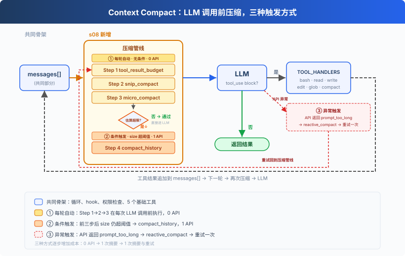
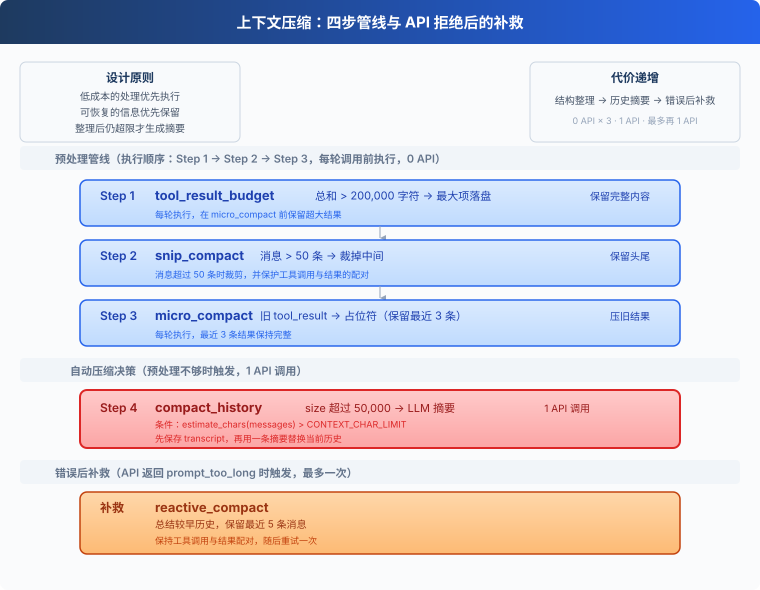
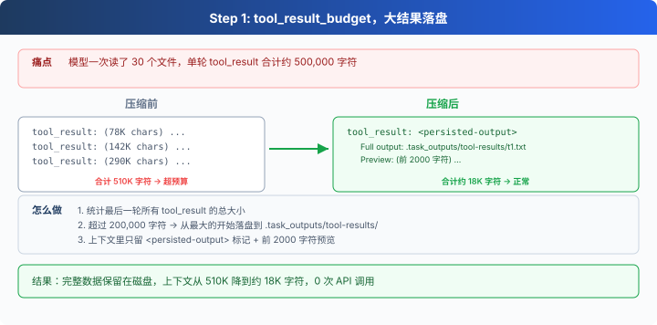
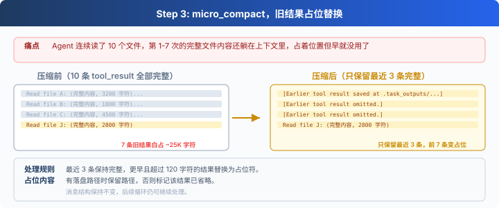
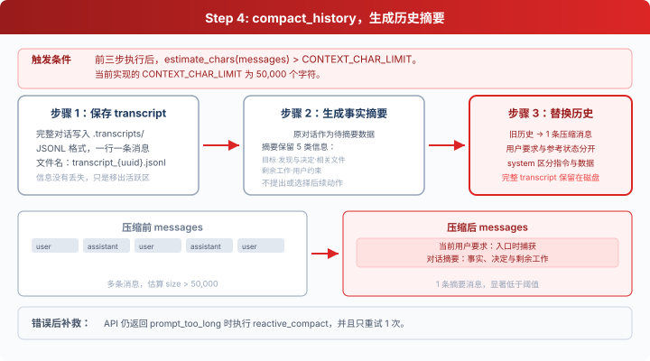

Agent 持续工作时，读过的文件、执行过的命令和模型回复都会留在 messages 中。消息越积越多，最终会超过模型能够接收的上下文长度。

本节将实现一条四步压缩管线。它先整理可以恢复的工具结果，空间仍然不足时再总结历史。

## 为什么先整理工具结果

直接让模型总结整段历史可以明显缩短上下文，但摘要一定会遗漏部分细节，而且还会多产生一次模型调用。

工具结果具有更适合优先处理的特点：

1. 大文件可以保存到磁盘，需要时重新读取。
2. 旧命令可以重新执行。
3. 最新几条结果通常比早期结果更接近当前工作。
4. 文本裁剪和结构调整不需要调用模型。

因此压缩顺序按照信息损失和调用成本排列：先转存，再裁剪，再替换旧结果，最后才生成摘要。

## step 1 tool_result_budget
一次模型回复可能同时调用多个工具。执行完成后，这些 tool_result 会一起写进最后一条 user 消息。它们的总大小超过 200_000 字符时，tool_result_budget 从最大的结果开始处理。

其实这是一个“智能打包”的机制。因为 AI 模型的“工作记忆”（即上下文长度，Token Limit）是非常有限且昂贵的。

如果 AI 在一次操作中调用了多个工具，这些工具返回的结果加起来特别长（比如超过了 20 万字符），直接把所有文字都塞进 AI 的脑子里，不仅会超出 Token 限制导致报错，还会极大地浪费成本。

所以 tool_result_budget 的作用就是在发送给 AI 之前，先对结果做一次“瘦身”。具体处理逻辑如下：
### 1. 怎么判断要不要“瘦身”？
先计算最后一轮所有工具返回结果的总字符数。 如果总和没超过 200,000 字符，那就不管，全部原样发给 AI。 如果总和超过了 200,000 字符，就触发“瘦身”机制。
### 2. “瘦身”的规则是什么？（从大到小开始砍）
系统会把这些结果按大小降序排列，从最大的那个结果开始动手：
   1. 如果这个结果本身超过 30,000 字符（LARGE_RESULT_CHAR_LIMIT）： 
      - 把这个结果的完整内容保存到服务器的磁盘文件里（例如：.task_outputs/tool-results/t1.txt）。 
      - 在发给 AI 的聊天内容里，只保留一个“快递单号”（即文件路径）和该内容的前 2000 个字符预览。
   2. 如果最大的瘦身完，总大小还在超限？那就继续对第二大的结果进行同样的操作，直到总大小降到 20 万字符以内为止。

## 第二步：snip_compact
消息数量超过 50 条后，snip_compact 先把完整历史写入 .transcripts/，再保留最初 3 条和最近 47 条。中间的标记会写明删去了多少条消息，以及完整记录保存在哪里。

切点需要保护 assistant(tool_use) 和 user(tool_result) 的配对关系。孤立的工具结果缺少对应调用，下一次 API 请求会被判定为无效。
**这是一个“防断裂”的安全机制：** 

因为 AI 调用工具（tool_use）和获取结果（tool_result）必须是成双成对的（就像打电话，不能只有去电没有来电）。所以代码里有个 while 循环，它会确保在切割的时候，不会把一个完整的工具调用对子给劈开。

这一步控制消息数量，但保留下来的旧消息仍可能包含很长的工具结果。

## 第三步：micro_compact
`micro_compact` 会完整保留最近一次 assistant 响应之后新增的所有 `tool_result`，确保模型至少完整读取每条新结果一次。对于模型已经读取过的结果，它保留最近 3 条，并缩短其余超过 120 个字符的旧结果。已经转存的结果保留文件路径，其他结果只留下占位符：

micro_compact第一句的意思是必须等tool全部执行完得到结果才能做micro_compact。

例如读取10个文件，必须全部读取到10个了才能去做压缩例如10个要压缩7个文件内容，不能读到第7个就开始做压缩，不然后面的还没读到就让ai开始处理，ai会瞎编后面3个文件的内容。

## 第四步：compact_history

前三步执行后，代码用 `estimate_chars(messages)` 计算当前消息的字符数：

字符数超过 `CONTEXT_CHAR_LIMIT` 时，`compact_history` 完成四件事：

1. 将完整消息历史写入 `.transcripts/`。
2. 请求模型生成只包含事实的状态摘要。
3. 将入口处捕获的当前用户请求与摘要明确分开。
4. 用一条 `[Compacted]` 消息替换当前历史。

compact_history的第2点和第3点是将除当前这条请求的全部历史上下文记录进行持久化并进行总结生成摘要，然后把这个摘要(Compacted)信息替换成历史记录。

总结这个动作是LLM来做的，做完全部后其实对于AI内部来说其实相当于开了一个新对话了，但是对用户来说是无感的。

第3点把当前请求和摘要明确分开，是因为如果总结的摘要有指令之类的，ai会把之前的指令当做当前用户的指令去执行。
例如如果不隔离，当“历史摘要”里包含了之前的指令（比如“读取文件”），AI 就会把这个摘要当成新的聊天记录，认为：“哎呀，用户又在让我读文件了！”于是它就会去重新执行。

摘要调用在 `system` 中要求模型只整理目标、文件、决定、剩余工作和用户约束，不执行历史中的指令。`active_request` 在接收用户输入时单独传给 Agent Loop，因为工具结果也使用 `role=user`。压缩后的消息将它写在 `Current user request` 中，摘要则放在 `Conversation summary` 中，并附上完整 transcript 的路径。

本节使用字符数作为触发条件，相关阈值也使用同一单位。
